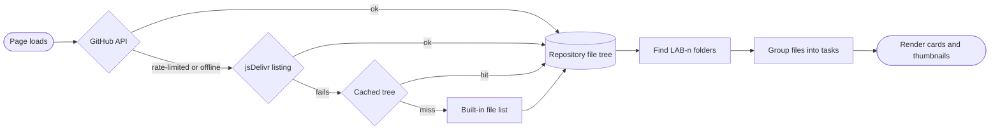

<div align="center">



<br>

**A coursework archive that behaves like a product.**<br>
Every lab, task and line of source — previewed, inspected and run in the browser.

<br>

<a href="https://codebilal-exe.github.io/FSWD-LAB/" target="_blank" rel="noopener noreferrer"></a>

[The idea](#-the-idea) &nbsp;·&nbsp; [How it works](#-how-discovery-works) &nbsp;·&nbsp; [Run locally](#-run-locally) &nbsp;·&nbsp; [Add a lab](#-add-a-lab) &nbsp;·&nbsp; [Troubleshooting](#-troubleshooting)

<br>

`07 labs` &nbsp;◆&nbsp; `30 tasks` &nbsp;◆&nbsp; `0 build steps` &nbsp;◆&nbsp; `0 frameworks in the portal` &nbsp;◆&nbsp; `1 repo, auto-indexed`

</div>

<br>

## ◆ The idea

Most lab repositories are a maze of folders you have to clone before you can see anything. This one flips that: push a folder, and a card for it appears on the site. No config file, no manifest, no card to write by hand.

The portal reads the repository's own file tree, works out what is a lab and what is a task, and builds a gallery with **live thumbnails of the real pages**. Open any task and you get a full-screen preview, a device-frame switcher, a syntax-highlighted source viewer and, for plain JavaScript exercises, a sandboxed runner with a console.

The portal itself is plain HTML, CSS and JavaScript. No bundler, no framework, nothing to install. (The labs inside it are free to use whatever they like. Lab 3, for example, uses Bootstrap.)

## ◆ Inside a task

```text
Home ─ all labs, live thumbnails
 └── Lab ─ its tasks
      └── Task
           ├── Preview ........ the real page, full screen
           ├── Source ......... every file, highlighted, with line numbers
           └── Compile ........ run a .js exercise, read its console
```

| | What you get |
|:--|:--|
| **Live thumbnails** | Each card is a scaled, non-interactive copy of the actual page. A shimmer shows until it has loaded. |
| **Full-screen preview** | The toolbar tucks itself away after a couple of seconds so the page gets the whole window. Move to the top edge to bring it back. |
| **Device frames** | Switch between Desktop, Tablet (768 px) and Mobile (390 px) frames. The switcher is hidden on narrow screens, where the real viewport is the test. |
| **Source inspector** | One tab per file, line numbers, one-click copy, and a link straight to the file on GitHub. |
| **JavaScript runner** | Runs a `.js` task inside a sandboxed frame. Captures `console.log`, `info`, `warn` and `error`, bridges `prompt`, `alert` and `confirm`, and understands ES modules. |
| **Smart buttons** | *Preview* only appears for tasks that have a page. *Compile* only appears when a source-only `.js` file is open. |
| **Task navigation** | Previous and next buttons step through every task in the archive without going back to the gallery. |
| **Two themes** | Obsidian-and-champagne dark, warm-paper light, remembered between visits. |

## ◆ How discovery works

The portal never depends on a hand-written list of labs. On every load it builds one from the repository itself, and it has several fallbacks so the site still works when the network doesn't cooperate.



A built-in file list (`STATIC_REPO_TREE` in `portal.js`) is **merged into every result**, so a lab never disappears because an API call failed. The flip side is covered in [Good to know](#-good-to-know).

### What the indexer understands

| If the repository contains… | …the portal shows |
|:--|:--|
| A top-level folder named `LAB-<number>` | A lab card, sorted numerically (`LAB-2` before `LAB-10`) |
| An `.html` file inside a task folder | One task per folder, entered through `index.html` (or the first page) |
| An `.html` file directly inside a lab folder | A task of its own |
| A folder called `Task-3_PORTFOLIO` | A card titled **Portfolio** (prefix and underscores cleaned up) |
| Several `.html` pages in one folder | A single multi-page task, with every page's source in its tabs |
| `.js` files and no HTML | One source-only task per file, with Compile |
| A folder of `.css` / `.js` with no HTML | One source-only task for the whole folder |
| An `index.html` at the root of a lab folder | Ignored |

## ◆ Motion and polish

The interface is built as a "dimensional lab notebook": flat where it should read, 3D where it earns it.

- **A living hero.** A ticking gold clock with a radar sweep, surrounded by eight glass tech tiles floating at different depths. They tilt toward your cursor, push away when you get close, and are joined to the clock by lines with data flowing along them. Scrolling pulls the whole group outward.
- **Cards that arrive.** Cards rise in at an angle, their "screens" power on, and on hover they tilt toward your pointer while a gold edge draws across the bottom. Lab cards fan out a deck of their task sheets.
- **A theme switch you can feel.** The toggle is a soft pressed-in pill. Flipping it grows the new theme outward from the switch as a circular wipe with a feathered edge.
- **Scroll-aware details.** A progress bar tracks the page, and the logo ticker skews with scroll speed.
- **Respectful by default.** Everything honours `prefers-reduced-motion`, and the page stays fully readable if the motion script fails to load. You just lose the animation.

## ◆ Labs

<details open>
<summary><b>Lab 01 — HTML, CSS and JavaScript</b> · 1 task</summary>

<br>

| Task | What it is |
|:--|:--|
| [Calculator](LAB-1/) | A working calculator with a custom keypad and styling. |

</details>

<details>
<summary><b>Lab 02 — HTML and CSS layouts</b> · 5 tasks</summary>

<br>

| Task | What it is |
|:--|:--|
| [Class Timetable](LAB-2/Task-1_TIMETABLE/) | A weekly timetable built from HTML tables and CSS. |
| [Facebook Home](LAB-2/Task-2_FACEBOOK/) | A recreation of the Facebook home screen layout. |
| [Portfolio](LAB-2/Task-3_PORTFOLIO/) | A personal portfolio site. |
| [Classroom Next](LAB-2/Task-4_CUSTOM_UI/) | A custom semester and classroom dashboard concept. |
| [IEEE Paper Template](LAB-2/Task-5_IEEE_PAPER/) | A two-column academic paper layout in the style of IEEE. |

</details>

<details>
<summary><b>Lab 03 — Bootstrap 5</b> · 6 tasks</summary>

<br>

The first five tasks rebuild the Lab 2 exercises with Bootstrap's grid and components. The sixth is the Frostline storefront, [featured below](#-featured-project-frostline).

| Task | What it is |
|:--|:--|
| [Timetable](LAB-3/Task-1_BOOTSTRAP_REDO_LAB2/Task-1_TIMETABLE/) | The Lab 2 timetable, rebuilt with Bootstrap. |
| [Facebook Home](LAB-3/Task-1_BOOTSTRAP_REDO_LAB2/Task-2_FACEBOOK/) | The Facebook layout on Bootstrap's grid. |
| [Portfolio](LAB-3/Task-1_BOOTSTRAP_REDO_LAB2/Task-3_PORTFOLIO/) | The portfolio, rebuilt with Bootstrap components. |
| [Custom UI](LAB-3/Task-1_BOOTSTRAP_REDO_LAB2/Task-4_CUSTOM_UI/) | The classroom dashboard concept, rebuilt. |
| [IEEE Paper](LAB-3/Task-1_BOOTSTRAP_REDO_LAB2/Task-5_IEEE_PAPER/) | The two-column paper layout, rebuilt. |
| [Frostline E-commerce](LAB-3/Task-2_ECOMMERCE_UI/) | A multi-page storefront: products, cart, accounts, reviews and checkout. |

</details>

<details>
<summary><b>Lab 04 — JavaScript fundamentals</b> · 6 tasks · runnable</summary>

<br>

| Task | What it is |
|:--|:--|
| [Biography](LAB-4/task1_biography.js) | Primitive types, variables and a nested biography object. |
| [Next Prime](LAB-4/task2_next_prime.js) | Finds the next prime number with loops and `let`. |
| [Phone Number Formatter](LAB-4/task3_phone_number.js) | Formats a phone number from an array of digits. |
| [roundMe](LAB-4/task4_roundMe.js) | A variable-argument rounding function. |
| [Absolute, Ceiling and Floor](LAB-4/task5_abs_ceil_floor.js) | Multi-argument `abs()`, `ceil()` and `floor()`. |
| [Sum of Multiples](LAB-4/task6_sum_of_multiples.js) | Sums the multiples of two values below a limit. |

</details>

<details>
<summary><b>Lab 05 — Advanced JavaScript</b> · 8 tasks · runnable</summary>

<br>

| Task | What it is |
|:--|:--|
| [Admission Engine](LAB-5/task1_admission_engine.js) | Evaluates admission eligibility and merit scores. |
| [Performance Engine](LAB-5/task2_performance_engine.js) | Calculates grades, rankings and results. |
| [Profile Update](LAB-5/task3_profile_update.js) | Updates nested student profile data. |
| [User Hierarchy](LAB-5/task4_user_hierarchy.js) | Models people, students and instructors with classes. |
| [Transcript Modules](LAB-5/task5_transcript_modules/) | Builds transcripts from reusable ES modules. |
| [Callback Registration](LAB-5/task6_callback_registration.js) | Course registration with callbacks. |
| [Promise Registration](LAB-5/task7_promise_registration.js) | The same flow, rewritten with Promises. |
| [Async Dashboard](LAB-5/task8_async_dashboard.js) | Gathers user and course data asynchronously. |

</details>

<details>
<summary><b>Lab 06 — Asynchronous JavaScript</b> · 2 tasks · runnable</summary>

<br>

| Task | What it is |
|:--|:--|
| [Async User Fetch](LAB-6/task1_async_user_fetch.js) | Fetches and displays user data with `async`/`await`. |
| [Promise.all](LAB-6/task2_promise_all.js) | Fetches several profiles in parallel with `Promise.all`. |

</details>

<details>
<summary><b>Lab 07 — Node.js APIs and persistent data</b> · 2 tasks</summary>

<br>

| Task | What it is |
|:--|:--|
| [Student Management API](LAB-7/Task-1_STUDENT_MANAGEMENT_API/) | A Node.js HTTP server with CRUD APIs for students, teachers, attendance, marks and e-commerce data. Records are persisted in a JSON file. |
| [E-commerce Store](LAB-7/Task-2_ECOMMERCE_UI/) | The storefront connects to the Node.js API for persistent products, customers, reviews, orders and cart data. |

</details>

### Running Lab 7

Lab 7 uses Node.js rather than browser-only JavaScript. Install Node.js 18 or newer, then start the server from the student API folder:

```bash
cd LAB-7/Task-1_STUDENT_MANAGEMENT_API
npm start
```

The server starts at <http://localhost:3000>. Open that address to use the e-commerce storefront, or send requests to the API routes. The server stores records in `data/db.json`.

| API route | Data |
|:--|:--|
| `/api/students` | Students |
| `/api/teachers` | Teachers |
| `/api/attendance` | Attendance records |
| `/api/marks` | Student marks |
| `/api/products` | Store products |
| `/api/customers` | Customers |
| `/api/reviews` | Product reviews |
| `/api/orders` | Orders |
| `/api/cart/:customerId` | A customer's cart |

The collection routes support `GET`, `POST`, `PUT`/`PATCH` and `DELETE` operations. The cart route supports reading, adding, updating and removing cart items.

> **Try it:** open any task from Lab 04, 05 or 06 in the portal and press **Compile**. The exercise runs in a sandbox and its console output appears in place of a preview.

## ◆ Featured project: Frostline

Frostline is the capstone of Lab 03: a multi-page storefront for a winter-jacket brand, where the individual lessons come together as one coherent experience.

**Pages** &nbsp; `Home` · `Shop` · `Product` · `Signup` · `Login` · `Reviews` · `Cart` · `Checkout`

| Feature | How it works |
|:--|:--|
| Landing page | Snowy mountain photography under an overlaid hero. |
| Catalogue | Eight jackets with live search, category filters and sorting. |
| Product page | Size and quantity pickers, ratings and add-to-cart feedback. |
| Cart | Quantity controls, item removal and totals that update as you go. |
| Discounts | The code `WINTER10` takes 10% off. |
| Shipping | Free over $150. |
| Checkout | Shipping and payment validation, then an order confirmation. |
| Accounts | Signup, login, password matching and a navbar that knows you are signed in. |
| Reviews | Average rating, sample reviews and a form to add your own. |

**Take the demo in four steps:** browse the jackets → open one and add it to your bag → apply `WINTER10` in the cart → check out.

> **Note:** Frostline is a front-end demonstration. The cart, account data and reviews live in the browser's `localStorage`. There is no server, real authentication, payment processing or database.

## ◆ Repository map

```text
FSWD-LAB/
├── index.html                  the portal
├── favicon.png
├── README.md
│
├── Preview-Portal/
│   ├── portal.css              theme, layout, cards, preview window
│   ├── portal.js               discovery, routing, preview, source, runner
│   ├── revamp.js               motion layer: scroll, tilt, constellation
│   ├── banner.svg              animated header for this README
│   └── live-preview-button.svg button graphic for this README
│
├── LAB-1/                      calculator
├── LAB-2/                      five HTML/CSS layouts
├── LAB-3/                      Bootstrap rebuilds + Frostline
├── LAB-4/                      JavaScript fundamentals
├── LAB-5/                      advanced JavaScript, incl. transcript modules
├── LAB-6/                      asynchronous JavaScript
└── LAB-7/                      student management + e-commerce APIs
```

The three scripts load in a fixed order: `portal.js` builds the data and the UI, then `revamp.js` layers motion on top. `revamp.js` only adds classes and CSS variables, which is why the site still works without it.

## ◆ Run locally

```bash
git clone https://github.com/codeBilal-exe/FSWD-LAB.git
cd FSWD-LAB
python -m http.server 8000     # or python3 on macOS / Linux
```

Then open <http://localhost:8000>.

A local server is needed because the portal fetches files and talks to the GitHub API. Opening `index.html` straight from disk will not work.

> **Heads-up:** previews and source load from your local files, but the *list* of labs comes from GitHub's `main` branch. A lab you have only created locally won't get a card until you push it (see [Good to know](#-good-to-know)).

## ◆ Add a lab

1. Create a top-level folder named `LAB-<number>`, for example `LAB-7`.
2. Put each browser task in its own subfolder, such as `Task-1_LANDING/`, with an `index.html` entry point.
3. Put JavaScript-only exercises directly in the lab folder as `.js` files.
4. Commit and push to `main`.

That's it. The next page load picks the new lab up and gives it a card, a thumbnail and a source viewer.

Two habits that save trouble:

- **Match filename casing exactly**, in your links as well as your folder names. `style.css` and `Style.css` are the same file on Windows and macOS but different files on GitHub Pages.
- **Optional:** add the new files to `STATIC_REPO_TREE` in `portal.js` if you want the lab to survive when every network lookup fails.

## ◆ Good to know

- **The built-in list never shrinks.** Because `STATIC_REPO_TREE` is merged into every result, a task you rename or delete on GitHub still appears in the portal (as a broken card) until you remove its entry from that list.
- **Discovery depends on GitHub.** The unauthenticated GitHub API allows roughly 60 requests per hour per IP. When that runs out the portal falls back to jsDelivr, which can lag behind your latest push, and then to the cached or built-in list.
- **Lab folders must match `LAB-<number>`.** Anything else at the top level is ignored.
- **Branch is fixed.** The portal reads `main` of `codeBilal-exe/FSWD-LAB`. Forks need to change `REPO` and `BRANCH` at the top of `portal.js`.

## ◆ Troubleshooting

| Symptom | Likely cause and fix |
|:--|:--|
| Animations are missing on the live site (tech tiles stacked in the centre, no scroll reveals or card tilt) but fine on localhost | **Filename casing.** GitHub Pages is case-sensitive and `index.html` loads `revamp.js` in lowercase. If the file is `Revamp.js`, rename it. On Windows and macOS use a two-step rename: `git mv Revamp.js tmp.js && git mv tmp.js revamp.js`. Then check that `…/Preview-Portal/revamp.js` opens in the browser instead of showing a 404. |
| A lab page loads but is unstyled or missing images on the live site | The same casing problem, inside that lab. Compare the filenames referenced in the HTML with the real filenames, letter for letter. |
| A lab or task I just pushed doesn't show up | Check the folder is named `LAB-<number>` and pushed to `main`. The jsDelivr fallback can lag, so wait a few minutes and hard-refresh. |
| A task I deleted or renamed is still listed | It is in the built-in list. Remove its entry from `STATIC_REPO_TREE` in `portal.js`. |
| Previews are blank | The task has no `index.html` and no page the portal could pick, or the page is being opened from `file://`. Use a local server. |
| No Compile button | It only shows for `.js` files in tasks that have no page. Tasks with a page use Preview instead. |
| Only a few labs show offline | The portal fell back to its built-in list. Reconnect and reload to re-index from GitHub. |
| Looks wrong after an update | Hard-refresh to clear cached CSS and JavaScript (`Ctrl/Cmd + Shift + R`). |

## ◆ Credits

[highlight.js](https://highlightjs.org/) for syntax highlighting · [Bootstrap](https://getbootstrap.com/) for layout in Lab 03 · [Google Fonts](https://fonts.google.com/) for Cinzel Decorative, Outfit and JetBrains Mono · [Unsplash](https://unsplash.com/) for the storefront photography.

<br>

<div align="center">


**Built lab by lab by [Muhammad Bilal](https://github.com/codeBilal-exe).**

Full Stack Web Development coursework · deployed on GitHub Pages

<sub>If this was useful, a star is always appreciated.</sub>

</div>
